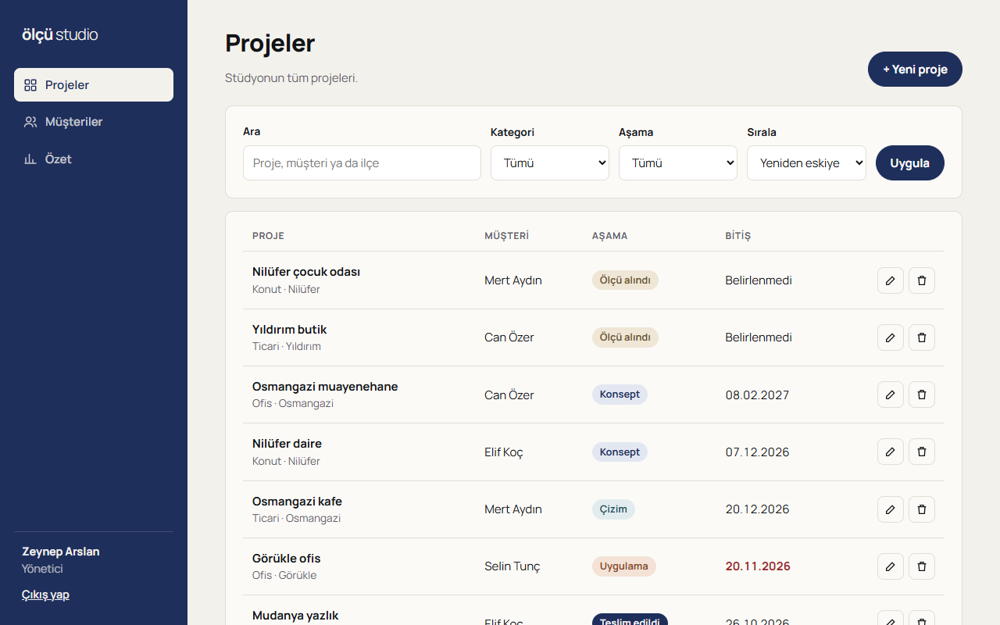
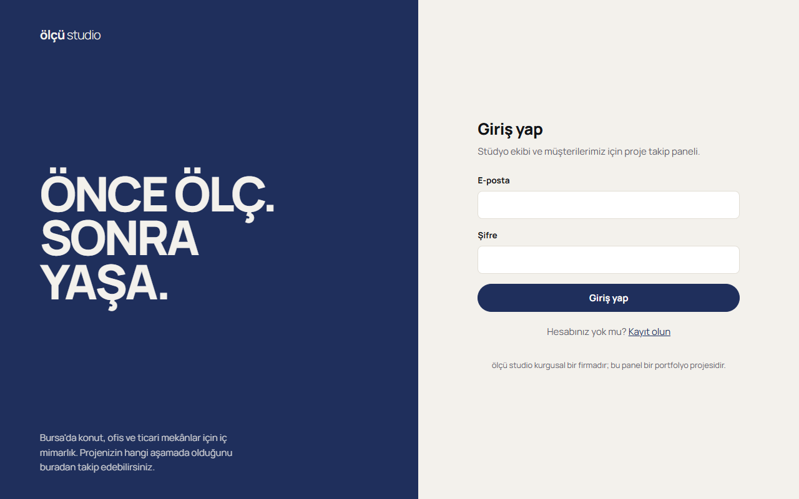
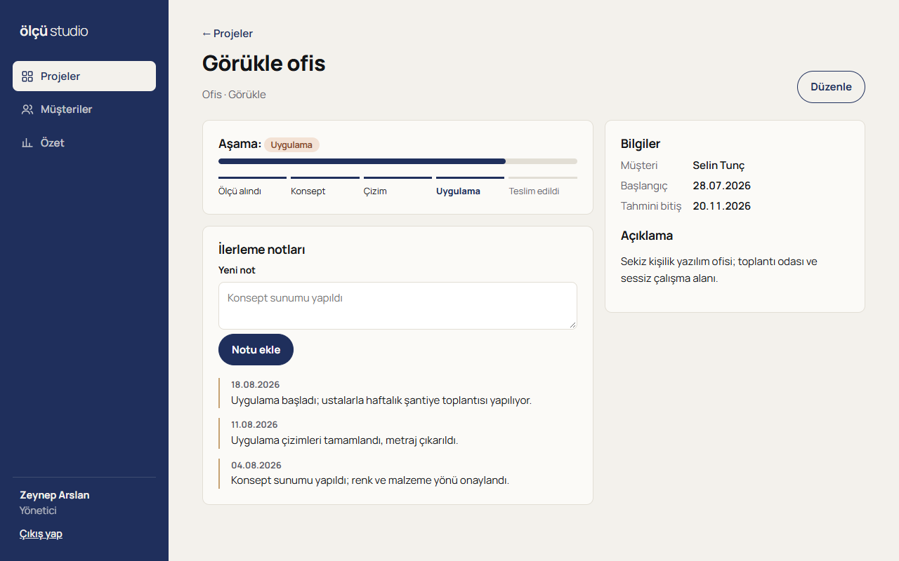
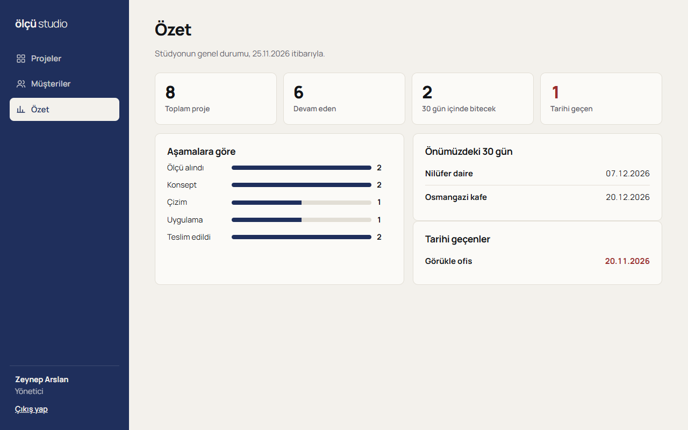
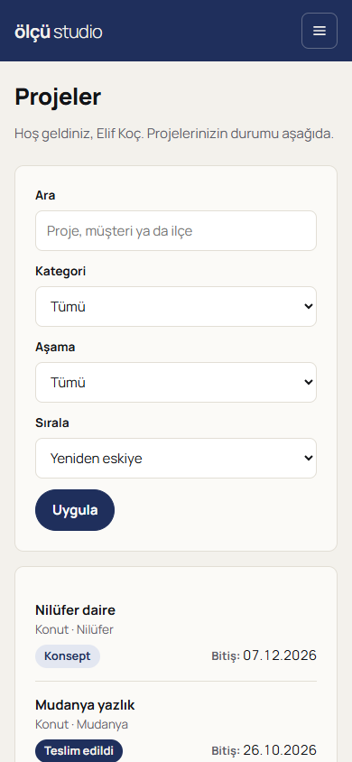

# ölçü studio · Yönetim Paneli

İnternet Programcılığı dersinde **Mini CRM** ödevi olarak başladı; teslimden sonra adım adım geliştirdim. **ölçü studio**, Bursa'da konut, ofis ve ticari mekân tasarlayan kurgusal bir iç mimarlık stüdyosu. Panelde stüdyo ekibi müşterileri ve projeleri yönetir, müşteriler de kendi projelerinin hangi aşamada olduğunu takip eder.

> ölçü studio kurgusal bir firmadır; bu panel bir portfolyo projesidir. Örnek veriler uydurmadır.



| Giriş | Proje detayı | Özet | Telefonda |
|---|---|---|---|
|  |  |  |  |

## Özellikler

- **İki rol:** Yönetici müşterileri ve projeleri yönetir; müşteri yalnızca kendi projelerini görür, hiçbir şeyi değiştiremez.
- **İç mimarlık aşamaları:** Ölçü alındı → Konsept → Çizim → Uygulama → Teslim edildi. Projeler Konut, Ofis ve Ticari olarak ayrılır, ilçe bilgisi tutulur.
- **Arama, filtre, sıralama:** Proje, müşteri ya da ilçeye göre arama (Türkçe harflere duyarlı: "nilüfer" ile "NİLÜFER" aynı sonucu verir); kategori ve aşama filtresi; tarihe göre sıralama.
- **Proje detayı:** Aşama çubuğu ve tarihli ilerleme notları. Yönetici not ekler, müşteri okur.
- **Özet sayfası:** Aşamalara göre dağılım, önümüzdeki 30 günde bitecekler, tarihi geçenler.
- **Müşteriler sayfası:** Her müşterinin toplam ve devam eden proje sayısı.
- **Telefona uyumlu**, klavyeyle gezilebilir, hareket azaltma tercihine saygılı arayüz.

## Teknolojiler

- ASP.NET Core MVC (.NET 8), C#
- SQL Server Express, ADO.NET (`Microsoft.Data.SqlClient`) ile **elle yazılmış, parametreli SQL**
- Oturum (session) tabanlı giriş, şifreler `PasswordHasher` ile karıştırılarak (hash) saklanır
- xUnit ile 46 otomatik test
- Kütüphanesiz HTML ve CSS; yazı tipi Manrope (yerel dosya, SIL Open Font License)

## Kurulum

Gerekenler: [.NET 8 SDK](https://dotnet.microsoft.com/download) (veya daha yenisi) ve SQL Server Express (`.\SQLEXPRESS`).

```powershell
# 1. Veri tabanını kur (OlcuStudioDb; varsa silinip yeniden kurulur)
sqlcmd -S .\SQLEXPRESS -E -f 65001 -i database\olcu-studio.sql

# 2. Uygulamayı çalıştır (Development ortamında demo verisi otomatik eklenir)
dotnet run --project MiniCRMProject --launch-profile http

# 3. Testler
dotnet test
```

Tarayıcıda `http://localhost:5140` adresini açın.

**Demo hesapları**

| Rol | E-posta | Şifre |
|---|---|---|
| Yönetici | `yonetici@olcustudio.test` | `Olcu2026!` |
| Müşteri | `elif@olcustudio.test` (ayrıca `mert@`, `selin@`, `can@`) | `Musteri2026!` |

## Teslimden sonra yaptığım geliştirmeler

Okulda teslim ettiğim hâl [`okul-teslimi`](https://github.com/demiraloznur/olcu-studio-panel/tree/okul-teslimi) etiketinde duruyor (yalnızca örnek kişiler uydurma isimlerle değiştirildi ve kaynağı belirsiz iki görsel çıkarıldı). Sonrasında her adımı ayrı bir commit olarak yaptım:

| Ne eksikti | Ne yaptım | Commit |
|---|---|---|
| Bir dosyada Türkçe karakterler bozuktu | Dosya kodlamasını düzelttim; bunu yakalayan ilk testi yazdım | [0e7a9dd](https://github.com/demiraloznur/olcu-studio-panel/commit/0e7a9dd) |
| SQL sorguları controller'ların içindeydi | Davranışı değiştirmeden repository sınıflarına taşıdım | [1f37142](https://github.com/demiraloznur/olcu-studio-panel/commit/1f37142) |
| Şifreler düz metin saklanıyordu | Şifreleri karıştırarak (hash) saklıyorum; yanlış şifre ile bilinmeyen e-posta aynı mesajı veriyor | [92ecfa7](https://github.com/demiraloznur/olcu-studio-panel/commit/92ecfa7) |
| Müşteri, adres çubuğuna başka bir projenin numarasını yazarak onu düzenleyebiliyordu | Her sayfaya oturum ve rol kontrolü ekledim | [aaeb4ce](https://github.com/demiraloznur/olcu-studio-panel/commit/aaeb4ce) |
| Formlar doğrulanmıyordu | Zorunlu alan, e-posta biçimi, en az 8 karakter şifre, aynı e-postayla ikinci kayıt engeli | [73b2647](https://github.com/demiraloznur/olcu-studio-panel/commit/73b2647) |
| Durumlar yazılım projesine göreydi, arama yoktu | ölçü studio'ya uyarladım: kategori, aşama, ilçe; arama, filtre ve sıralama | [f2fb5f9](https://github.com/demiraloznur/olcu-studio-panel/commit/f2fb5f9) |
| Müşteri yalnızca bir tablo görüyordu | Aşama çubuklu proje detay sayfası ve ilerleme notları | [7546176](https://github.com/demiraloznur/olcu-studio-panel/commit/7546176) |
| Yöneticinin genel bakışı yoktu | Özet ve müşteriler sayfaları | [c917381](https://github.com/demiraloznur/olcu-studio-panel/commit/c917381) |
| Tasarım hazır bir şablona dayanıyordu | Bootstrap'i kaldırıp kendi CSS'imle ölçü studio kimliğini uyguladım; telefon uyumu | [ef156c2](https://github.com/demiraloznur/olcu-studio-panel/commit/ef156c2) |

## Proje yapısı

```
database/olcu-studio.sql        Veri tabanı şeması
MiniCRMProject/
  Controllers/                  Account, Home (projeler), Customers, Dashboard
  Data/                         SQL sorguları (repository sınıfları), demo verisi
  Models/                       Proje, aşama, kategori, filtre, özet hesapları
  Security/                     Oturumdaki kullanıcı, yetki filtreleri
  Services/PasswordService.cs   Şifre karıştırma
  Views/, wwwroot/              Arayüz
MiniCRMProject.Tests/           xUnit testleri
```

## Lisans ve kaynaklar

Kod: Öznur Demiral. Manrope yazı tipi: [SIL Open Font License 1.1](MiniCRMProject/wwwroot/fonts/OFL.txt).
